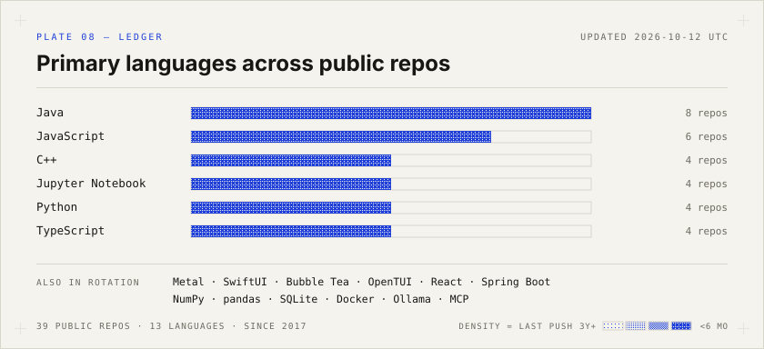

<picture>
  <source media="(prefers-color-scheme: dark)" srcset="./assets/husky-dark.gif">
  
</picture>

# Aditya Bankoti

**Computer Science · University of Washington, Seattle** Paul G. Allen School · Previously SWE Intern @ Costco Travel

[Portfolio](https://bankoti.dev) · [Writing](https://bankoti.dev/blog/) · [LinkedIn](https://www.linkedin.com/in/adityanb/) · [YouTube](https://www.youtube.com/@nano-ai) · [Photos](https://www.flickr.com/photos/204838303@N05/) · [Email](mailto:adityab7@uw.edu)

## Now & recently

- **UW Seattle:** CS at the Allen School. Transferred from UW–Madison in September 2026.
- **Costco Travel · Jun–Sep 2026:** Co-built a business-rules editor. Measured MVP release: 15 minutes; estimated legacy production cycle: 2–4 weeks.
- **Staff Code · 2021–2025:** Founded a free coding bootcamp under Hack Club’s fiscal sponsorship. Wrote the curriculum and taught 50+ students.

<b>Earlier experience</b>

- **iLink Digital · Jun–Aug 2024:** Data science intern. Cleaned public datasets with pandas and built Power BI dashboards.
- **Code Ninjas · Jul 2022–Feb 2024:** Taught programming in Java, C# and Lua.

## Selected work

| Project | What it does | Built with |
| :--- | :--- | :--- |
| [Orion](https://github.com/Nano-AI/Orion) · [Site](https://bankoti.dev/Orion/) | macOS RAW photo editor with GPU rendering. AI edit proposals can be approved in the app. | C++20, Metal, SwiftUI |
| [Process Desk](https://github.com/Nano-AI/process-desk) | Edit business processes and decision tables through a local LLM. Kogito validates each proposal before approval. | Java, React, Ollama |
| [VibeSys](https://github.com/uw-syfi/vibesys) | UW SyFI’s AI systems framework. Contributed [28 merged PRs](https://github.com/uw-syfi/vibesys/pulls?q=is%3Apr+author%3ANano-AI+is%3Amerged) across its terminal UI and evaluator. | TypeScript, Python, OpenTUI |
| [leetui](https://github.com/Nano-AI/leetui) · [Site](https://bankoti.dev/leetui/) | Solve LeetCode in the terminal, with offline search and your own editor. | Go, Bubble Tea |
| [Nazar](https://github.com/Dhruv-0-Arora/Nazar) | Offline diagnostics on Dell GB10. Co-built; 2nd of 40 teams at Dell × NVIDIA. | Python, Ollama |

<b>More projects</b>

- [Lake Day](https://github.com/Nano-AI/lake-day): Washington lake conditions on iOS. Shows closures and marks missing safety data as unknown. [Site](https://bankoti.dev/lake-day/)
- [AltiGoz](https://github.com/BerkM125/AltiGoz): Pedestrian routing using Seattle traffic cameras. I built the vision module at NVIDIA Spark Hack.
- [Asclepion](https://github.com/Dhruv-0-Arora/Asclepion): Co-built a clinical notes assistant that links findings to diagnoses. [Demo](https://www.youtube.com/watch?v=OM2pccC8T5A)
- [Cypher](https://github.com/Nano-AI/cascadia26): Conflict-risk map with XGBoost scoring. 3rd at CascadiaJS 2026.
- [Focus Tracker](https://github.com/Nano-AI/Focus-Tracker): Time tracking in the terminal, backed by SQLite.
- [Intro to Java](https://github.com/Nano-AI/intro-to-java): A beginner course with weekly assignments following UW’s CSE 142 outline.
- [IMC Prosperity 4](https://github.com/Nano-AI/imc-prosperity-4): Two-person trading project through Round 4. Options pricing and market making, tuned on released data.
- [Fegis](https://fegis.vercel.app/): Browser extension that checks for sensitive data locally before it reaches an AI tool.
- [MedCheck](https://github.com/Nano-AI/Med-Check): Drug-batch verification on Ethereum. 3rd in Badger Build Fest’s blockchain track. [Demo](https://www.youtube.com/watch?v=cdb0WkGtaUc)

<b>Earlier experiments</b>

 

**Graphics:** [Java ray tracer](https://www.youtube.com/watch?v=9r9MSqD6vKc) · [ray caster](https://www.youtube.com/watch?v=U9RTGmFqN7U) · [fractal renderer](https://www.youtube.com/watch?v=baKRlHixcQY) · [Godot PSX scene](https://www.youtube.com/watch?v=1s81vzSt3_g) · [C++/RayLib collider](https://www.youtube.com/watch?v=-c1E1xJwxCU)

**AI & ML:** [NumPy digit recognizer](https://www.youtube.com/watch?v=c63ioyWuPUM) · [Smarty Pants](https://www.youtube.com/watch?v=PzeFaZ95Kig), scholarship search with RAG · [LLM-dev](https://github.com/Nano-AI/LLM-dev)

**Games:** [SAT-Shark](https://www.youtube.com/watch?v=VZJzt6scgBU), multiplayer SAT prep · [Pac-Man](https://www.youtube.com/watch?v=TIrYUZJPQ_k) · [C++/SDL2 chess](https://www.youtube.com/watch?v=EjIU1NLMAPk) · [WinGDI sand simulator](https://www.youtube.com/watch?v=jb5hq8EoAU8) · [Unity shooter](https://www.youtube.com/watch?v=i5At7d9uaQ0)

**Web:** [CleanEats](https://github.com/Nano-AI/CleanEats), barcode nutrition lookup ([demo](https://www.youtube.com/watch?v=FSq0EKt5-Bs)) · [Litter.ly](https://github.com/Nano-AI/litter.ly), community clean-ups ([demo](https://www.youtube.com/watch?v=dlUDO7SRVz8))

Other hackathons: Bludify, top-5 finalist at Yoodli (2025); SAT-Shark, Best Functionality at HackPNW (2024).

## Writing

- [Morris Worm Incident](https://bankoti.dev/blog/posts/2026-05-21-buffer-overflows/): A buffer overflow explained through a small C program.
- [Ways to Decompose a Face](https://bankoti.dev/blog/posts/2026-04-23-eigenfaces/): Reconstructing faces with NumPy’s SVD and custom NNMF.

## What I build with

Java · C++ · Swift · Go · Python · TypeScript 
Spring Boot · React · Metal · SwiftUI · Bubble Tea · OpenTUI 
NumPy · pandas · Ollama · MCP

<picture>
  <source media="(prefers-color-scheme: dark)" srcset="./assets/stats-dark.svg">
  
</picture>

Counts repositories by primary language, not bytes or proficiency. HTML, CSS, and SCSS excluded. Refreshed weekly by [`scripts/build-stats.mjs`](./scripts/build-stats.mjs) from the GitHub API.

---

Profile reviewed October 12, 2026 · [bankoti.dev](https://bankoti.dev)
